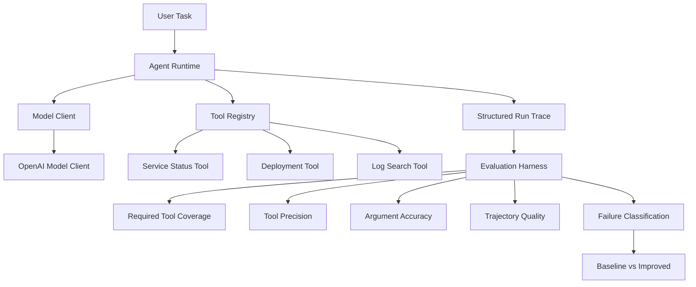

# Agent Runtime Evals

A lightweight, production-oriented runtime and evaluation framework for tool-using AI agents.

This project focuses on a problem that is often missing from agent demos:

> **How do we evaluate and improve the way an agent executes, not just whether it eventually produces a correct answer?**

The runtime manages the execution lifecycle between an LLM and external tools, records structured traces, enforces execution guardrails, handles transient failures, and evaluates agent behavior at the trajectory level.

> 🚧 **Project Status: Active Development**
>
> The core runtime, tool execution system, tracing, retry handling, and evaluation pipeline are functional. I am continuing to expand the benchmark, improve runtime guardrails, strengthen failure handling, and explore additional agent workloads.

---

## Why This Project?

A tool-using agent can return the correct answer while still following a poor execution path.

For example, an agent may:

- call unnecessary tools,
- repeat the same tool multiple times,
- use incorrect arguments,
- stop before collecting enough evidence,
- continue after enough evidence is already available,
- or fail to recover cleanly from transient tool failures.

This project evaluates both:

- **Task correctness** — did the agent complete the requested task?
- **Trajectory quality** — did it use the right tools, arguments, sequence, and amount of work?

The goal is not only to make an agent succeed, but to make its behavior **observable, measurable, and improvable**.

---

## Architecture



The architecture separates model reasoning from execution infrastructure.

The model decides:

```text
What should I do next?
```

The runtime decides:

```text
How should that decision be executed safely and consistently?
```

---

## Core Agent Loop

The runtime follows a bounded model-tool execution loop:

```text
User Task
   ↓
Model Decision
   ↓
Tool Call or Final Answer
   ↓
Validate Tool Arguments
   ↓
Execute Tool
   ↓
Record Observation
   ↓
Update Execution History
   ↓
Model Decision
```

The model returns structured decisions such as:

```text
ToolCallDecision
```

or:

```text
FinalDecision
```

This gives the runtime an explicit contract for whether execution should continue or terminate.

---

## Agent Runtime Responsibilities

`AgentRuntime` is responsible for:

- invoking the model,
- executing tool calls,
- maintaining execution history,
- validating execution flow,
- enforcing maximum step limits,
- handling retries,
- recording structured traces,
- and determining when a run succeeds or fails.

The runtime intentionally does **not** own:

- model reasoning,
- domain-specific incident logic,
- provider-specific model behavior,
- or the implementation details of individual tools.

A useful design principle for the project is:

> **The model owns semantic decisions. The runtime owns execution guarantees.**

---

## Model Abstraction

The runtime does not depend directly on a specific model provider.

Instead, it depends on a `ModelClient` abstraction.

```text
              ModelClient
                  ▲
          ┌───────┴────────┐
          │                │
 OpenAIModelClient   ScriptedModel
          │                │
      Live Runs      Unit Tests
```

This provides two important benefits.

### Provider independence

`AgentRuntime` only needs something capable of producing an `AgentDecision`.

The runtime does not need to know whether that decision comes from OpenAI, another provider, or a local model.

### Deterministic testing

Production execution can use `OpenAIModelClient`, while unit tests use a deterministic `ScriptedModel`.

That allows runtime behavior to be tested without:

- API keys,
- network access,
- API cost,
- or model nondeterminism.

---

## Tool System

Tools are registered through a `ToolRegistry`.

Each tool exposes:

- a name,
- a description,
- a typed argument schema,
- and an execution method.

Current incident-response tools include:

```text
get_service_status
get_recent_deployments
search_logs
```

The registry centralizes:

- tool registration,
- tool lookup,
- argument validation,
- execution,
- and tool schema exposure to the model.

Internally, the registry may use a dictionary, but the abstraction represents a broader execution contract.

> The dictionary is the storage mechanism; `ToolRegistry` is the domain abstraction.

---

## Typed Tool Contracts

Tool arguments are validated using Pydantic schemas before execution.

For example:

```python
class GetServiceStatusArgs(BaseModel):
    service: str
```

A model-generated tool call such as:

```json
{
  "service": "payments-api"
}
```

can be validated before the underlying tool executes.

This creates a clear boundary between probabilistic model output and deterministic application code.

---

## Structured Tracing

Each run records structured execution events.

A trace can contain:

- model decisions,
- tool calls,
- tool arguments,
- tool results,
- retry attempts,
- errors,
- latency,
- final answers,
- and final run status.

Example execution:

```text
MODEL
  ↓
get_service_status(payments-api)
  ↓
TOOL_RESULT: degraded
  ↓
MODEL
  ↓
search_logs(payments-api)
  ↓
TOOL_RESULT: merchant_context validation error
  ↓
MODEL
  ↓
get_recent_deployments(payments-api)
  ↓
TOOL_RESULT: v2.4.1 introduced stricter validation
  ↓
MODEL
  ↓
FINAL
```

Structured traces are used for both debugging and offline evaluation.

---

## Runtime Guardrails

The runtime places deterministic boundaries around probabilistic model behavior.

### Maximum execution steps

A configurable `max_steps` prevents an agent from continuing indefinitely.

```text
Probabilistic model decisions
            ↓
Deterministic execution bound
```

If the model does not produce a final answer within the configured step budget, the run terminates with a bounded failure state.

### Tool retries

Transient tool failures can be retried within a configurable retry budget.

```text
Tool Attempt 1
      ↓
Transient Failure
      ↓
Backoff
      ↓
Tool Attempt 2
      ↓
Success
```

Permanent failures are not automatically retried.

Retry behavior belongs in the runtime rather than the LLM because retries are an execution reliability policy, not a reasoning task.

### Retry behavior

The runtime distinguishes between transient and permanent failures.

Examples:

```text
Temporary service failure
→ retry

Invalid request
→ fail fast
```

This keeps recovery bounded and predictable.

---

## Evaluation Harness

The evaluation framework measures both correctness and execution quality.

Current evaluation dimensions include:

- Task Success
- Required Tool Coverage
- Tool Precision
- Argument Accuracy
- Answer Term Coverage
- Exact Tool Sequence Match
- Duplicate Tool Calls
- Repeated Tool Calls
- Extra Tool Calls
- Tool Call Efficiency
- Model Latency
- Tool Latency
- Trajectory Pass Rate

---

## Required vs Allowed Tools

Evaluation cases distinguish between:

```text
required_tools
```

and:

```text
allowed_tools
```

A required tool must be called for a task to be considered complete.

An allowed tool may be reasonable to call but is not always necessary.

For example:

```text
Task:
"Is there evidence of an active checkout incident?"
```

may define:

```text
required:
- get_service_status
- search_logs

allowed:
- get_service_status
- search_logs
- get_recent_deployments
```

This prevents the evaluator from penalizing valid alternative execution paths.

---

## Failure Classification

The evaluator classifies several categories of execution failure:

```text
missing_required_tool
unnecessary_tool
incorrect_tool_arguments
missing_answer_evidence
duplicate_tool_call
repeated_tool_use
extra_tool_call
incorrect_tool_sequence
```

This provides more information than a single pass/fail score.

For example:

```text
Task Success = true
Trajectory Pass = false
```

means the agent may have reached the correct final answer while following an inefficient or unnecessary execution path.

---

## Evaluation-Driven Improvement

The benchmark was used to identify concrete behavioral problems such as:

- over-tooling,
- repeated tool use,
- unnecessary diagnostic calls,
- and poor stopping behavior.

The agent policy was then revised to encourage:

- minimum sufficient evidence,
- intent-aware tool selection,
- fewer repeated calls,
- earlier stopping,
- and stronger grounding in tool evidence.

### Baseline vs Improved

| Metric | Baseline | Improved |
| --- | ---: | ---: |
| Task Success | 100.0% | 100.0% |
| Trajectory Pass | 83.3% | **91.7%** |
| Required Tool Coverage | 100.0% | 100.0% |
| Tool Precision | 94.4% | **95.8%** |
| Argument Accuracy | 100.0% | 100.0% |
| Answer Term Coverage | 100.0% | 100.0% |
| Tool Call Efficiency | 90.3% | **95.8%** |
| Extra Tool Calls | 2 | **1** |
| Duplicate Tool Calls | 0 | 0 |

The policy improvement increased execution quality without reducing task correctness.

```text
Task Success
100.0% → 100.0%

Trajectory Pass
83.3% → 91.7%

Tool Call Efficiency
90.3% → 95.8%
```

The project therefore evaluates not just whether an agent works, but whether its execution behavior improves over time.

---

## Offline Trace Replay

Execution and evaluation are intentionally separated.

Saved traces can be replayed against updated evaluator logic without calling the model again.

```text
Saved Execution Trace
        ↓
Updated Evaluator
        ↓
Recomputed Metrics
```

This provides several benefits:

- no additional API cost,
- no additional model variance,
- reproducible evaluation,
- easier evaluator debugging,
- and fairer baseline comparisons.

---

## Reliability Testing

The deterministic test suite includes failure-injection scenarios.

### Transient failure recovery

```text
Attempt 1
   ↓
Retryable Failure
   ↓
Attempt 2
   ↓
Success
```

### Retry budget exhaustion

```text
Attempt 1 → FAIL
Attempt 2 → FAIL
Attempt 3 → FAIL
             ↓
      Retry budget exhausted
```

### Permanent failure

```text
Permanent Error
      ↓
No Retry
```

This verifies that retry behavior remains bounded and deterministic.

---

## Project Structure

```text
agent-runtime-evals/
│
├── runtime/
│   ├── config.py
│   ├── errors.py
│   ├── model.py
│   ├── openai_model.py
│   ├── runner.py
│   ├── schemas.py
│   └── tool_registry.py
│
├── tools/
│   ├── deployments.py
│   ├── log_search.py
│   └── service_status.py
│
├── evals/
│   ├── dataset.json
│   ├── evaluator.py
│   ├── metrics.py
│   ├── report.py
│   └── results/
│
├── tests/
│   ├── fakes.py
│   ├── test_agent_loop.py
│   ├── test_evaluator.py
│   ├── test_tool_registry.py
│   └── test_tool_retries.py
│
├── compare_evals.py
├── demo_live.py
├── replay_evals.py
├── run_evals.py
├── requirements.txt
└── README.md
```

---

## Running Locally

### 1. Clone the repository

```bash
git clone https://github.com/YOUR_USERNAME/agent-runtime-evals.git
cd agent-runtime-evals
```

### 2. Create a virtual environment

```bash
python -m venv .venv
source .venv/bin/activate
```

### 3. Install dependencies

```bash
python -m pip install -r requirements.txt
```

### 4. Run the deterministic test suite

```bash
python -m pytest -v
```

---

## Live Model Execution

Create a `.env` file in the project root:

```text
OPENAI_API_KEY=your_api_key_here
```

Do not commit `.env` to GitHub.

Run the live demo:

```bash
python demo_live.py
```

---

## Running Evaluations

Run the live evaluation benchmark:

```bash
python run_evals.py
```

Replay previously saved traces:

```bash
python replay_evals.py \
  --trace-dir evals/results/baseline_traces \
  --output evals/results/baseline_final.json
```

Compare baseline and improved results:

```bash
python compare_evals.py
```

---

## Testing Strategy

The project separates deterministic software testing from live-model evaluation.

### CI / Unit Tests

Unit tests use `ScriptedModel` and do not require:

- external API access,
- an OpenAI API key,
- network access,
- or probabilistic model behavior.

### Live Agent Evaluation

Live evaluations use the real model client and are run separately because they:

- depend on an external model provider,
- introduce nondeterminism,
- and incur API usage.

This keeps the core runtime continuously testable while still supporting realistic model evaluations.

---

## Current Scope

The project is intentionally lightweight.

The current runtime is:

```text
single-process
evaluation-focused
tool-oriented
trace-driven
```

It is **not currently** a distributed durable workflow engine.

The project does not yet provide:

- distributed workers,
- workflow recovery across process crashes,
- durable timers,
- persistent long-running workflows,
- human approval workflows,
- multi-agent orchestration,
- or production observability integrations.

The current focus is on understanding and improving the execution behavior of tool-using agents before expanding into larger infrastructure concerns.

---

## Ongoing Development

🚧 This project is still actively evolving.

Current and planned areas of improvement include:

- expanding the evaluation benchmark,
- adding more ambiguous and adversarial test cases,
- strengthening runtime guardrails,
- improving error recovery,
- improving trace analysis and reporting,
- evaluating additional agent workloads,
- exploring persistent execution state,
- investigating durable workflow orchestration,
- and testing additional model providers.

The project follows an evaluation-driven development approach:

```text
Build
  ↓
Measure
  ↓
Inspect Failures
  ↓
Improve Runtime / Policy
  ↓
Re-evaluate
```

New features are intended to be driven by observed failure modes rather than added only for feature count.

---

## Design Principles

The project follows several core principles:

```text
Model owns semantic decisions.

Runtime owns execution guarantees.

Tools expose typed capabilities.

Execution history makes the agent stateful.

Traces make behavior observable.

Evaluation makes behavior measurable.

Benchmarks drive improvement.
```

The project intentionally does not try to become a large general-purpose agent framework.

Instead, it focuses on a narrower question:

> **How should a tool-using agent be executed, observed, evaluated, and improved when model reasoning becomes part of a multi-step execution loop?**

---

## Status

**Active Development**

The core runtime and evaluation pipeline are functional, while benchmark coverage, runtime policies, reliability mechanisms, and evaluation depth are continuing to improve.